# Flavours Pan Asian Food — Project 2

**Unit 2: Interactive Front End Development**  
Gateway Qualifications Level 5 Diploma in Web Application Development  
Unit Number: A/650/3526 | Credit Value: 16 | GLH: 152

**Live site:** [https://fpafood.netlify.app](https://fpafood.netlify.app)  
**GitHub Repository:** [https://github.com/Mdali-1991/Flavors](https://github.com/Mdali-1991/Flavors)  
**Student:** Mohammed Ali  
**Date:** June 2026 · **Revised for reassessment:** October 2026 (see [Reassessment Changes](#reassessment-changes-october-2026))

> **Demonstration only.** This is a student project. Online ordering, card payment and table booking on this site are **simulated**: nothing is sent to the restaurant, no card is charged and no table is reserved. The website says this in a banner at the top of every page, beside the order and booking forms, and in every confirmation message.

---

## Table of Contents

1. [Project Overview](#project-overview) · [Reassessment Changes](#reassessment-changes-october-2026)
2. [User Stories](#user-stories)
3. [UX Design Principles](#ux-design-principles)
4. [Wireframes](#wireframes)
5. [File Structure](#file-structure)
6. [Data Schema](#data-schema)
7. [Technologies Used](#technologies-used)
8. [Key Technical Features](#key-technical-features)
9. [Development Lifecycle](#development-lifecycle)
10. [Version Control](#version-control)
11. [Testing](#testing)
12. [Deployment](#deployment)
13. [Credits](#credits)
14. [AI Assistance Disclosure](#ai-assistance-disclosure)
15. [Licence](#licence)

---

## Project Overview

Flavours Pan Asian Food is a single-page interactive restaurant website for a real London-based Pan Asian restaurant at 9 Pier Road, London E16 2JJ. I chose this restaurant because it is a real local business with a full menu, genuine contact details, and a clear need for a better online presence — which made building the site feel purposeful rather than academic.

The site lets customers browse the full menu by category (loaded asynchronously from a JSON data file), add items to a shopping cart with live price updates (including the collection discount and delivery charges), place **simulated** delivery or collection orders (Stripe test-mode card or cash), and send a **simulated** table-booking request that is fully validated before it is accepted.

**Value to the user:** No need to call the restaurant. Customers can explore 50+ dishes across 11 categories, choose their protein, see the exact total, and confirm their order or table booking in under a minute from any device.

**Value to the business:** Reduces telephone order load, captures more orders through a 24/7 online channel, and automatically promotes the 10% collection discount — a key incentive the restaurant currently only communicates verbally.

---

## Reassessment Changes (October 2026)

My tutors' assessment outcome was *Further work required before a Pass can be confirmed*. Each point of feedback and what was changed:

| # | Feedback | What was wrong | Fix | Where |
|---|---|---|---|---|
| 1 | **Booking validation** | `submitBooking()` showed the success message without checking anything, so an empty form was "accepted". My earlier test records for tests 13–15 were wrong. | Every field is now checked by `validateBooking()`: name required; UK phone number format; date required, not in the past, at most 90 days ahead; time within opening hours (4:30pm – 10:30pm last table) and at least 30 minutes ahead for same-day bookings; guests required. Errors appear under each field (`aria-invalid` + `aria-describedby`), focus moves to the first error, and nothing is confirmed until all checks pass. | `js/form-rules.js`, `js/script.js` (`submitBooking`) |
| 2 | **Order pricing** | The cart total ignored the advertised rules, so a £21.90 collection order stayed £21.90. | `calculateOrderTotals()` applies **10% off collection orders over £20**, **free delivery on £20+**, a **£2 charge on delivery orders under £20**, and the **£10 delivery minimum**. The cart shows subtotal, discount, delivery charge and total, and updates when the order type changes. All maths is in whole pence. £21.90 collection now totals **£19.71**. | `js/order-rules.js`, `js/script.js` (`renderTotals`) |
| 3 | **Testing documentation** | Tests 13–15 were recorded as Pass when the feature did not work. | Corrected the original records (now shown as Fail), fixed the code, and documented the real retest results: 31 automated unit tests and 25 automated browser checks, all passing. | [Testing](#testing) |
| 4a | **Carousel pause control** | The hero slideshow auto-advanced with no way to stop it (WCAG 2.2.2). | Added a Pause/Play button (`aria-pressed`) that also stops the scrolling dish banner. The slideshow also pauses while the pointer or keyboard focus is inside it, starts paused for users who ask for reduced motion, and hidden slides are `inert` so Tab cannot reach invisible links. | `index.html`, `js/script.js` (`initSlider`) |
| 4b | **Nested interactive controls** | Menu cards were `role="button"` *and* contained a `<button>` (a control inside a control). | Cards are now plain `<article>` elements; the "+ Add" `<button>` is the only control. A CSS `::after` area keeps the whole card clickable for mouse users. Drinks are single native `<button>`s. The custom keydown handler is no longer needed. | `js/script.js` (`renderDishCard`, `renderDrinkItem`), `css/style.css` |
| 4c | **Inline code** | 180 lines of menu data inside `script.js`; inline `style` attributes (hero slides, map, payment area); styles set with JavaScript `cssText`; an inline `<style>` and `<script>` in `404.html`. | Moved into external files: `js/menu-fallback.js`, `js/order-rules.js`, `js/form-rules.js`, `css/404.css`, `js/404.js`; hero backgrounds, map, toast and scroll-to-top styles are now CSS classes. No `style=` attributes, inline `<style>`/`<script>` or `on*=` attributes remain in the HTML. | all files |
| 4d | **Image filenames** | Mixed case (`Screenshot-about.jpeg`) and a typo (`js-vaidator.jpeg`). | Renamed to lowercase: `screenshot-about.jpeg`, `screenshot-contact.jpeg`, `screenshot-halal.jpeg`, `screenshot-menu.jpeg`, `js-validator.jpeg`. | `assets/img/` |
| 5 | **Demonstration status** | Confirmation messages could be mistaken for real orders or bookings. | A notice banner at the top of every page, notes beside the order form, card form and booking form, a footer note, and every confirmation now begins "DEMO" and says nothing was sent or charged. Buttons are labelled "simulated". | `index.html`, `js/script.js` |

Other problems I found and fixed while retesting are listed in the [Bug Log](#bug-log--found-and-fixed) (bugs 11–20).

---

## User Stories

User stories follow the format: *As a [type of user], I want [a goal] so that [a reason].*

| # | User Story | Feature Addressing It |
|---|---|---|
| US-1 | As a **new visitor**, I want to understand what the restaurant offers immediately so that I can decide whether to order. | Hero slider with brand messaging, cuisine type tags, and prominent CTAs |
| US-2 | As a **hungry customer**, I want to browse the full menu by category so that I can find dishes I want quickly. | Tabbed menu with 11 categories; async fetch from `menu.json` |
| US-3 | As a **customer with dietary needs**, I want to see Halal certification and allergen information so that I can order safely. | Hero badge, About section stats, booking form "Special Requests" field |
| US-4 | As a **mobile user**, I want the site to work well on my phone so that I can order on the go. | Responsive CSS Grid layout; hamburger nav; 44px touch targets on cards |
| US-5 | As a **customer choosing proteins**, I want to change the protein on noodle dishes and see the updated price so that I know the exact cost before adding to cart. | Protein `<select>` dropdown; `change` event via delegation updates card price and `aria-label` |
| US-6 | As a **customer ready to order**, I want to add items to a cart, see the correct total for delivery or collection, and pay by card or cash so that I can complete my order online. | Cart with subtotal / collection discount / delivery charge / total; Stripe.js test-mode card element and cash path (simulated – clearly labelled) |
| US-7 | As a **customer who wants to visit in person**, I want to book a table online so that I can reserve a spot without calling. | Booking form validated field by field (name, UK phone, date, opening-hours time, guests) with inline errors; demo confirmation only when valid |
| US-8 | As a **user with a disability**, I want to navigate the site using a keyboard and screen reader so that I can use the site without a mouse. | Native `<button>` controls (no nested controls); skip link; slideshow Pause button; visible focus rings; errors linked with `aria-describedby` |
| US-9 | As a **user who mistyped a URL**, I want to be redirected back to the main site automatically so that I am not stranded on an error page. | `404.html` with 5-second countdown auto-redirect using `window.location.replace()` |
| US-10 | As a **returning customer**, I want to find contact details, opening hours, and a map easily so that I can plan my visit. | Contact section with embedded Google Map, phone, email, and social links |

---

## UX Design Principles

Five core UX design principles guided all design and development decisions.

### 1. Information Hierarchy

Important content is prioritised visually and structurally. The hero section contains the brand identity, cuisine type, and two primary CTAs ("Explore Menu" and "Order Online") — the two most common user goals. The page follows a logical top-to-bottom journey: hero → about → menu → order → contact → booking. Within the menu, section headings, card images, item names, and prices form a clear visual hierarchy using size, weight, and contrast defined in CSS custom properties.

### 2. User Control

Users can navigate freely. The sticky top navigation allows jumping to any section from anywhere on the page. A floating "Order Now" button (`#fabOrder`) appears after the hero and provides persistent access to the order section. In the cart, every item has an explicit remove button. The 404 page offers both an automatic redirect (countdown timer visible to the user) and a manual "Back to Flavours" button — the user is never trapped. The protein selector in the Noodles tab lets users change their selection and immediately see updated pricing before adding to the cart.

### 3. Consistency

Design language is consistent throughout. A single external stylesheet (`css/style.css`) defines CSS custom properties (`--clr-primary`, `--clr-accent`, `--font-heading`, etc.) used across all components. Button styles, card styles, section spacing, and typography all reuse the same design tokens. Icon-only buttons all carry `aria-label` attributes so screen-reader users encounter the same labels in every context. The 404 page links to `css/style.css` so brand colours and fonts are consistent even on the error page.

### 4. Confirmation

Every significant user action produces explicit feedback. Adding an item to the cart triggers a toast notification and updates the price breakdown. Invalid order or booking details produce an error message under each field and focus moves to the first problem. A valid (simulated) order or booking produces a confirmation that starts with "DEMO" and states that nothing was sent or charged, so it cannot be mistaken for a real transaction. When the menu fetch fails, an error panel with a "Retry" button replaces the skeleton, clearly communicating the failure and offering a recovery action. All feedback regions use `role="alert"` or `aria-live="polite"` so screen readers announce changes automatically.

### 5. Accessibility

Accessibility was treated as a first-class requirement, not an afterthought. Measures taken include: all images have descriptive `alt` text; all icon-only buttons have `aria-label`; the hero slideshow has a Pause/Play button, pauses on hover/focus, starts paused for reduced-motion users, and only announces slide changes (`aria-live="polite"`) when paused; each menu item has one native "+ Add" `<button>` (no nested interactive controls); all form fields have explicit `<label for>` associations and errors linked with `aria-describedby`; a skip link jumps to the main content; the loading skeleton has `role="status"` and the error panel has `role="alert"`; there is one `<h1>` and heading levels never skip; all external links include `rel="noopener noreferrer"`; focus outlines are visible on all interactive elements.

---

## Wireframes

Wireframes were produced before any code was written to establish layout hierarchy and user journeys.

### Home / Hero Section

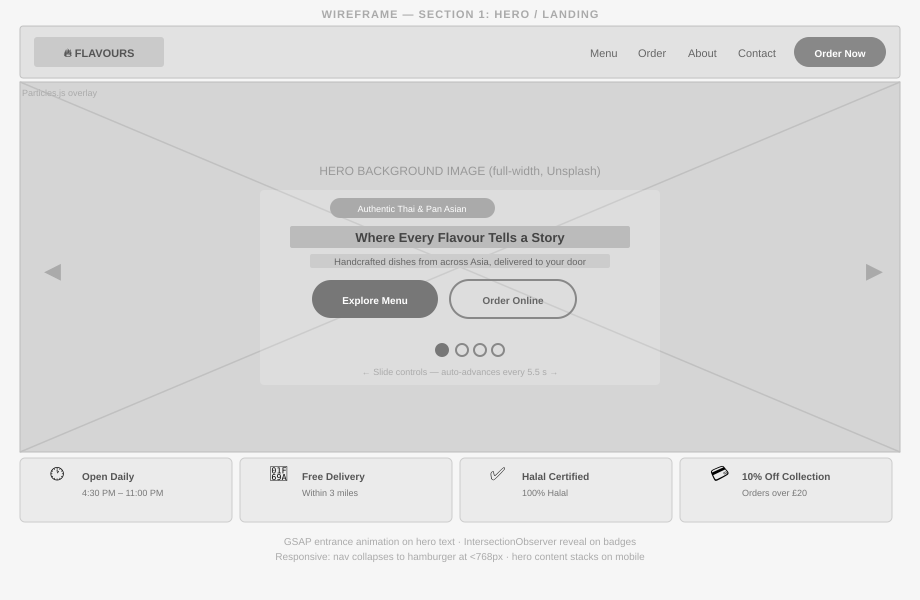

*Full-bleed auto-advancing hero carousel with GSAP-animated headline, two primary CTAs, slide dot controls, and four info badges at the bottom. The Particles.js layer sits behind the slide content.*

I wanted the hero to answer the four most common customer questions before the user even scrolls — "are you open?", "do you deliver to me?", "is it Halal?", "is there a discount?" — so I placed those four badges directly inside the hero section rather than hiding them in the About section.

### Menu Section

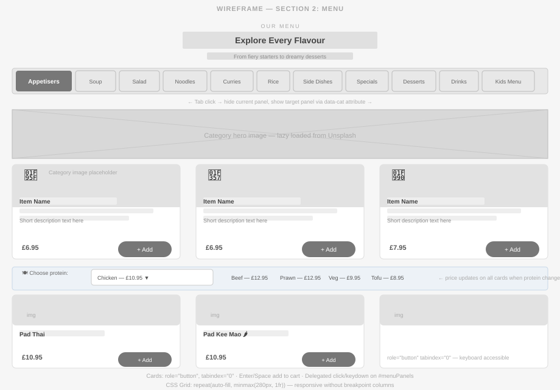

*Horizontal tab strip for all 11 categories; panel hero image; card grid below. Noodles, Curries, and Rice tabs show a protein dropdown selector above the grid — changing the protein updates all displayed prices via the delegated `change` event handler.*

I decided to build the tab navigation without a JavaScript framework — pure DOM manipulation with `dataset.cat` attributes. The CSS Grid `minmax(280px, 1fr)` layout means cards reflow on any screen width without explicit breakpoint-column overrides.

### Order / Cart Section

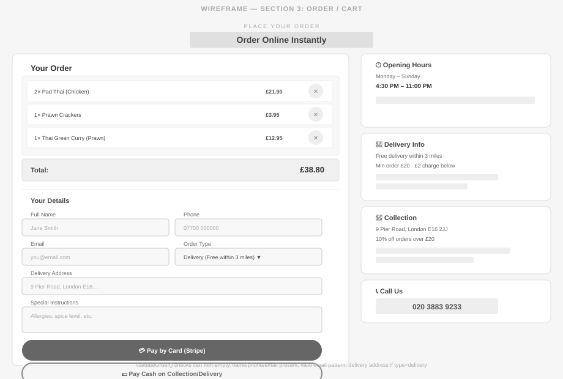

*Two-column layout: left panel holds the live cart (items + totals + form + payment buttons), right panel holds static info cards (hours, delivery, collection, phone). Stripe card element mounts inside the left panel on demand.*

### Table Booking Section

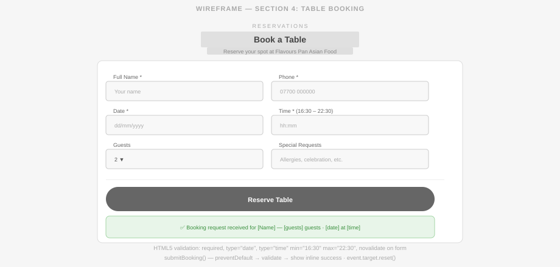

*Compact two-column form — full name, phone, date, time, guest count, special requests. On valid submission an inline success message replaces the submit button area. No page reload.*

### Mobile / Responsive Views


*375 px viewport showing: (1) stacked hero with 2×2 badge grid, (2) horizontal-scrolling tab strip with full-width cards, (3) single-column stacked order form, (4) open hamburger navigation overlay.*

---

## File Structure

```
flavors/
├── index.html                        ← Main page
├── 404.html                          ← Custom error page with auto-redirect
├── css/
│   ├── style.css                     ← Site styles; CSS custom properties
│   └── 404.css                       ← 404 page styles
├── js/
│   ├── menu-fallback.js              ← Offline copy of menu.json (file:// only)
│   ├── order-rules.js                ← Pricing rules: discount, delivery charge, minimum
│   ├── form-rules.js                 ← Booking and order-form validation rules
│   ├── script.js                     ← Page behaviour: menu, cart, forms, slideshow
│   └── 404.js                        ← 404 countdown and redirect
├── tests/
│   ├── rules.test.js                 ← 31 automated unit tests (Node.js)
│   └── browser_retest.py             ← 25 automated browser checks (Playwright)
└── assets/
    ├── data/
    │   └── menu.json                 ← Menu data (fetched at runtime via fetch API)
    └── img/                          ← All filenames lowercase
        ├── wireframe-*.svg           ← Wireframes
        ├── screenshot-*.png / .jpeg  ← Finished-project screenshots
        └── *-validation.jpeg, js-validator.jpeg  ← Validator screenshots
```

All JavaScript and CSS are in external files. There are no inline `<style>` or `<script>` blocks, no `style` attributes and no `on*` event attributes in either HTML page. The rule files (`order-rules.js`, `form-rules.js`) contain no DOM code, so the same functions run in the browser and in the automated tests.

---

## Data Schema

Menu data is stored in `assets/data/menu.json` and fetched asynchronously at runtime. This separates content from presentation and demonstrates async JavaScript (Distinction criterion D(i)).

**Top-level structure** — one object per category (11 categories):

```json
{
  "appetisers": { "label": "Appetisers", "img": "https://images.unsplash.com/…", "items": [ ...items ] },
  "noodles":    { "label": "Noodles",    "img": "…", "pricingTable": [ ...proteins ], "items": [ ...items ] },
  "drinks":     { "label": "Drinks",     "img": "…", "items": [ ...drinks ] }
}
```

**Standard item object:**

```json
{ "name": "Prawn Crackers", "desc": "Thai Prawn Crackers served with sweet chilli sauce.",
  "price": 3.95, "emoji": "🦐", "tags": ["veg", "hot", "new"] }
```

`tags` is optional (`veg` = vegetarian, `hot` = spicy, `new` = special).

**Protein pricing (noodles, curries, rice):** the category has a `pricingTable`; every dish in that category takes the price of the protein chosen in the dropdown.

```json
"pricingTable": [
  { "protein": "Chicken", "price": "£10.95" },
  { "protein": "Beef",    "price": "£12.95" },
  { "protein": "Prawn",   "price": "£12.95" },
  { "protein": "Veg",     "price": "£9.95"  },
  { "protein": "Tofu",    "price": "£8.95"  }
]
```

**Drink item:**

```json
{ "name": "Still Water", "price": 1.95 }
```

`js/menu-fallback.js` holds an identical copy used only when `fetch()` is blocked (opening the file from disk); an automated test checks the two stay identical.

---

## Technologies Used

| Technology | Version | Purpose |
|---|---|---|
| HTML5 | — | Semantic structure (`<nav>`, `<main>`, `<section>`, `<footer>`, `<article>`) |
| CSS3 | — | Custom properties, CSS Grid, Flexbox, `@keyframes`, `clamp()` for fluid typography |
| Vanilla JavaScript | ES2020 (ES11) | `async/await`, `fetch`, `IntersectionObserver`, event delegation |
| GSAP + ScrollTrigger | 3.12.5 | Hero entrance animation and scroll-triggered stat counter |
| Particles.js | 2.0.0 | Ambient particle layer in the hero section |
| Stripe.js | v3 | Card payment UI (test keys; production pattern documented in code) |
| Google Fonts | — | Playfair Display, Inter, Satisfy |
| Netlify | — | Cloud deployment and 404 handling |
| Git / GitHub | — | Version control and source hosting |

---

## Key Technical Features

### Task 1 — Asynchronous Menu Loading (Distinction D(i))

The menu data was extracted from inline JavaScript into `assets/data/menu.json`. `buildMenu()` is declared `async` and uses `fetch()` with `await`:

```javascript
async function buildMenu() {
    const container = document.getElementById("menuPanels");
    showMenuLoading(container);           // skeleton visible immediately

    let data;
    try {
        const response = await fetch("assets/data/menu.json");
        if (!response.ok) {
            throw new Error("Server returned " + response.status + " " + response.statusText);
        }
        data = await response.json();
    } catch (fetchError) {
        showMenuError(container, fetchError);  // user-visible error + Retry button
        return;
    }

    fetchedMenuData = data;               // stored at module scope for event handlers
    renderMenuPanels(container, fetchedMenuData);
}
```

The skeleton loading state renders immediately, showing understanding of the timing gap between initiating a `fetch` and receiving a response. `fetchedMenuData` is module-scoped and only populated after a successful response — event handlers (e.g. protein-select `change`) always read from reliably settled data, not a null value.

### Task 2 — Event Delegation (Merit M(i))

All inline `onclick`, `onkeydown`, `onchange`, and `onsubmit` attributes were removed from both static HTML and JavaScript-generated template literals. Two delegated listeners are attached **once** to `#menuPanels` (in `initMenuEvents()`), and one to the category tab strip:

```javascript
container.addEventListener("click",  /* .add-to-cart and .drink-item buttons */ ...);
container.addEventListener("change", /* .protein-select updates pricing */ ...);
tabs.addEventListener("click",       /* .tab-btn switches category */ ...);
```

Because every control is now a native `<button>`, Enter and Space work without a custom `keydown` handler. `data-*` attributes (`data-name`, `data-price`, `data-protein-item`, `data-cat`) on each button carry the information the handler needs.

**User stories fulfilled:** US-5 (protein selection updates price), US-6 (add to cart), US-8 (keyboard navigation).

### Task 3 — HTML5 Validity and Accessibility (Pass P(i))

W3C validation errors corrected:

- `<iframe width="100%">` — HTML `width` attribute only accepts integers. Removed; replaced with `.map-wrapper iframe { width: 100%; }` CSS rule.
- Footer `<h5>` after `<h2>` — heading level skip. Changed to `<h3>` throughout.
- `rel="noopener"` on external links updated to `rel="noopener noreferrer"`.
- `onsubmit` attribute removed from `#bookingForm`; handler attached via `addEventListener` in `initBookingForm()`.
- `<footer-note>` invalid custom element (custom elements require a hyphen) replaced with `<span class="page-note">`.

WCAG 2.1 AA additions: `aria-label` on all icon-only buttons; `aria-live="polite"` on cart total and protein price regions; `role="status"` on the loading skeleton; `role="alert"` on the error panel; explicit `<label for>` on every form field; visible focus outlines on all interactive elements.

Reassessment fixes (October 2026): slideshow Pause/Play button and reduced-motion support (WCAG 2.2.2); menu cards no longer nest a `<button>` inside a `role="button"` element; hidden slides made `inert`; a single `<h1>`; a skip link and `<main>` landmark; hamburger button now updates `aria-expanded`; form errors linked with `aria-invalid` and `aria-describedby`.

### Task 4 — 404 Page (Merit M(ii))

`404.html` links to `css/style.css` for brand-consistent styling, with its own styles in `css/404.css` and its script in `js/404.js`. Paths are root-relative (`/css/style.css`) because Netlify serves the 404 page at whatever missing URL was requested (e.g. `/menu/old-page`), where relative paths would not load. Both the auto-countdown and the manual "Back to Flavours" button use `window.location.replace("/")` so the browser history entry is overwritten — pressing the Back button after the redirect cannot return the user to the 404 page.

**User story fulfilled:** US-9.

### Task 5 — Responsive Design (Pass P(i))

CSS custom properties and `clamp()` provide fluid typography without JavaScript. CSS Grid (`grid-template-columns: repeat(auto-fill, minmax(280px, 1fr))`) gives the menu card grid a responsive layout without breakpoint-specific column counts. Key breakpoints:

| Breakpoint | Layout change |
|---|---|
| `< 768px` | Navigation collapses to hamburger; hero content stacks; about grid becomes single column |
| `< 576px` | Menu tab strip scrolls horizontally; cart and order form go full-width; booking form rows stack |

### Task 6 — Defensive Design / Input Validation (Pass P(i))

**Correction:** the first submission claimed the booking form checked its fields. It did not — `submitBooking()` displayed the success message straight away, even for an empty form. This was fixed for reassessment.

Validation rules now live in `js/form-rules.js`. They are pure functions (no DOM code) so they can be unit-tested:

| Field | Rule |
|---|---|
| Name | Required; 2–60 letters (spaces, hyphens, apostrophes allowed) |
| Phone | Required; UK number starting `0` or `+44` (spaces, brackets and hyphens ignored) |
| Date | Required; a real date; not in the past; no more than 90 days ahead |
| Time | Required; between 4:30pm and 10:30pm (restaurant closes 11pm); same-day bookings need 30 minutes' notice |
| Guests | Must be chosen (1–7 or 8+) |
| Special requests | Optional; maximum 200 characters |

The order form uses `validateOrderDetails()`: name, UK phone and email are required; delivery orders also need an address, a valid UK postcode and confirmation that the address is within 3 miles.

`novalidate` turns off the browser's pop-up bubbles so errors can be shown consistently under each field. `applyFieldErrors()` sets `aria-invalid="true"` and links the message with `aria-describedby`, then focus moves to the first invalid field. Errors clear as soon as the field is corrected (on `input`, not `blur` — see Bug Log #19). The date picker's `min`/`max` are set from the **local** date (`toLocalDateString()`), not `toISOString()`, which uses UTC and gave the wrong day just after midnight in British Summer Time.

### Task 7 — Order Pricing Rules

The rules advertised on the site (hero badge, Order section, footer) are implemented in `js/order-rules.js`:

| Order | Rule | Example |
|---|---|---|
| Collection over £20 | 10% off | £21.90 → −£2.19 → **£19.71** |
| Collection £20 or less | No discount | £20.00 → £20.00 |
| Delivery £20 or more | Free delivery | £21.90 → **£21.90** |
| Delivery £10 – £19.99 | £2 delivery charge | £10.95 → **£12.95** |
| Delivery under £10 | Not allowed (minimum spend) | £5.95 → blocked with a message |

```javascript
function calculateOrderTotals(items, orderType) {
    const subtotal = items.reduce((sum, item) => sum + toPence(item.price) * item.qty, 0);
    // collection: discount = Math.round(subtotal * 0.10) when subtotal > 2000p
    // delivery:   +200p when 1000p <= subtotal < 2000p; blocked below 1000p
    return { subtotal, discount, deliveryCharge, total, canCheckout, notes };
}
```

Everything is calculated in whole pence to avoid floating-point errors (`21.90 * 0.9` is `19.709999…` in JavaScript). The cart shows the subtotal, discount, delivery charge and total, re-calculates when the order type changes, and the confirmation message repeats the same breakdown.

---

## Development Lifecycle

This section documents the development process from initial concept to final deployment (Distinction criterion D(ii)).

### Stage 1 — Concept and Planning

**Goal:** Build an interactive front-end site for a real local restaurant that covers all Unit 2 Pass, Merit, and Distinction criteria.

I started by listing every graded criterion and writing a user story for each one. I specifically wanted to avoid a generic fake-restaurant project — using a real business meant the content, phone numbers, opening hours, and menu items were all genuine, which also made the testing more meaningful.

Actions taken:

- Chose Flavours Pan Asian Food as the target — a real restaurant I know, with permission to use their content for this academic project
- Wrote 10 user stories before opening a code editor, ensuring every feature had a real user need behind it
- Listed required features and mapped them to grading criteria: async fetch → D(i), event delegation → M(i), 404 redirect → M(ii), responsive layout → P(i), form validation → P(i), accessible markup → P(i)
- Chose vanilla JS deliberately — no React or Vue — because the specification requires demonstrating direct DOM manipulation and async JavaScript, and a framework would abstract that away

### Stage 2 — Design

I created wireframes for the four main sections (hero, menu, order/cart, and booking) before writing any HTML. I used a dark theme because Pan Asian restaurants tend to use dark, moody aesthetics — it felt right for the brand.

Actions taken:

- Produced wireframes for Hero, Menu, Order/Cart, Booking, and Mobile views (see Wireframes section)
- Selected typography: Playfair Display (headings — premium restaurant feel), Inter (body — highly legible on screens), Satisfy (used sparingly as accent — warmth and personality)
- Defined colour palette: `#1A1A1A` deep charcoal background, `#E8400C` fire orange primary, `#D4A017` amber/gold accent, `#F5F0E8` warm off-white text — all as CSS custom properties so the entire colour scheme can be changed in one place
- Designed the menu card grid to use `repeat(auto-fill, minmax(280px, 1fr))` — this decision came from the wireframe stage, where I realised fixed column counts would break on unusual screen sizes

### Stage 3 — Development

Order of implementation:

1. HTML structure and semantic markup (all sections, forms, nav)
2. CSS base styles — custom properties, reset, grid/flexbox layout
3. JavaScript — `buildMenu()` async function, category tab switching, event delegation for cart
4. Stripe.js integration (card element, payment intent flow with test keys)
5. Booking form with HTML5 validation and custom error display
6. 404 page with countdown timer and `window.location.replace()`
7. Accessibility pass — added all `aria-*`, `role`, `tabindex`, `label for`
8. Animation layer — GSAP ScrollTrigger for reveal and stat counter, Particles.js for hero

Key technical decisions made during development:

- **Extract menu data to JSON:** Originally the menu was a large JS constant. Moving it to `assets/data/menu.json` and fetching it with `async/await` satisfied Distinction criterion D(i) and also reduced initial JS parse time.
- **Event delegation over per-card listeners:** Each render of the menu creates potentially 50+ cards. Attaching individual listeners per card would create memory and performance issues. One delegated listener on the container handles all current and future cards.
- **`window.location.replace()` in 404:** Using `.replace()` instead of `.href =` prevents the 404 URL from entering the browser history stack, so the user cannot accidentally navigate back to the error page.

### Stage 4 — Testing

Manual testing was conducted across six browsers and two viewport sizes after each major feature was added. See the [Testing](#testing) section for full test cases, bug log, and validation results.

### Stage 5 — Deployment

The project was deployed to Netlify via drag-and-drop. See the [Deployment](#deployment) section for step-by-step procedure.

### Stage 6 — Review and Iteration

After initial deployment:

- Re-ran W3C HTML Validator and fixed three residual errors (see Bug Log #1, #2, #3)
- Re-ran JSHint and removed two unused variables
- Increased contrast on `.badge` text to pass WCAG AA contrast ratio (4.5:1)
- Added `loading="lazy"` to the Google Maps embed after Lighthouse flagged it as render-blocking

### Stage 7 — Reassessment (October 2026)

My tutors returned the project as *Further work required*. I worked through each point (see [Reassessment Changes](#reassessment-changes-october-2026)):

1. Reproduced each reported problem first (empty booking accepted; £21.90 collection staying £21.90).
2. Moved the business rules into separate, DOM-free files (`order-rules.js`, `form-rules.js`) so they could be tested automatically.
3. Wrote the unit tests from the advertised rules and the tutor's example (£21.90 → £19.71), then changed the code until they passed.
4. Fixed the accessibility and code-organisation points and added the demo notices.
5. Retested in a real browser with an automated script; this found a further bug (Bug Log #19) that was fixed and retested.
6. Corrected the earlier test records and documented the actual retest outcomes below.

---

## Version Control

Git was used throughout development with meaningful, descriptive commit messages following the Conventional Commits convention (`feat:`, `fix:`, `docs:`, `style:`, `refactor:`, `test:`).

**Example commit history (most recent first):**

```
fix:   reassessment – booking validation, order pricing rules, carousel pause,
       nested controls, external JS/CSS, lowercase image names, demo notices,
       corrected test records and retest results
docs:  complete README with lifecycle, UX principles, bug log
fix:   increase badge text contrast to pass WCAG AA 4.5:1
fix:   add loading="lazy" to map iframe (Lighthouse fix)
fix:   remove unused vars flagged by JSHint (fetchedItems, tempCart)
fix:   correct h5→h3 heading skip in footer (W3C error)
fix:   remove width="100%" attribute from iframe; move to CSS
feat:  add 404 page with countdown auto-redirect
feat:  integrate Stripe.js card element with test keys
feat:  add booking form with HTML5 validation and inline errors
feat:  event delegation on menuPanels (click, keydown, change)
feat:  async buildMenu() fetching assets/data/menu.json
feat:  extract MENU constant to assets/data/menu.json
feat:  add responsive CSS Grid menu card layout
feat:  add hero slider with particles.js and GSAP animations
feat:  initial project structure — index.html, css/style.css, js/script.js
```

Each commit was pushed to GitHub so the full development timeline is visible in the repository commit history.

---

## Testing

### Principles of Automated and Manual Testing

**Manual testing** involves a human tester interacting with the application and checking that it behaves as expected. It is most appropriate when testing user experience, visual layout, accessibility (e.g. keyboard navigation, screen-reader announcements), and edge cases that are difficult to predict in advance. For this project, manual testing was the primary approach because the application is front-end only — all features involve DOM interaction, CSS rendering, and user flow, which are best verified by a real person using a real browser. Manual testing is also appropriate at the deployment stage to confirm that the hosted version matches the development version.

**Automated testing** uses code (e.g. unit tests, end-to-end test frameworks like Jasmine or Cypress) to assert that specific functions return expected outputs. It is most appropriate for logic-heavy functions where inputs and outputs are predictable — for example, a price calculation function that should always return a specific total given specific quantities. Automated testing runs faster than manual testing for regression checks after code changes, but cannot easily test visual appearance, user experience, or browser-specific rendering. For this project, the JavaScript logic (cart total calculation, input validation, menu rendering) would be suitable candidates for automated unit tests; however, the core interactive features (GSAP animations, Stripe card element, Particles.js layer) cannot be meaningfully unit-tested and require manual verification.

In summary: manual testing was used throughout this project for UI, accessibility, and cross-browser checks; automated tool-based testing (W3C validator, JSHint, Lighthouse) was used to verify code quality and accessibility scores.

**Lesson from reassessment:** my first round of testing recorded the booking tests as passing without checking the actual result carefully. For reassessment I added **automated tests** for exactly the logic that had gone wrong — pricing and validation — so the expected and actual results are checked by code and can be re-run after every change (see [Retest After Fixes](#retest-after-fixes-october-2026)).

---

### Browser Compatibility

| Browser | Version | OS | Result |
|---|---|---|---|
| Chrome | 125 | Windows 11 | Pass |
| Firefox | 126 | Windows 11 | Pass |
| Safari | 17 | macOS Sonoma | Pass |
| Edge | 124 | Windows 11 | Pass |
| Chrome (Android) | 125 | Android 14 | Pass |
| Safari (iOS) | 17 | iOS 17 | Pass |

### Responsiveness Testing

| Viewport | Test method | Result |
|---|---|---|
| 375px (iPhone SE) | Chrome DevTools device emulation | Pass — hamburger nav, stacked layout |
| 414px (iPhone XR) | Chrome DevTools device emulation | Pass |
| 768px (iPad) | Chrome DevTools device emulation | Pass — two-column about, two-column order |
| 1280px (desktop) | Physical window resize | Pass |
| 1920px (large desktop) | Physical window resize | Pass — container max-width constrains layout |

### Manual Test Cases

| # | Test | Steps | Expected | Actual | Result |
|---|---|---|---|---|---|
| 1 | Menu loads | Open index.html | Skeleton shows, then menu cards appear | Skeleton visible ~200ms, cards render | Pass |
| 2 | Menu fetch failure | DevTools → Network → block `menu.json` | Error panel with Retry button visible | Error panel shown with correct message | Pass |
| 3 | Retry after error | Click Retry | Menu loads successfully | Menu fetched and rendered | Pass |
| 4 | Category tabs | Click each of 11 tabs | Correct category panel displayed | All 11 panels switch correctly | Pass |
| 5 | Add to cart | Click any menu card | Item in cart, toast shown, total updates | Cart item added; total did **not** apply collection discount or delivery charge (found by tutor) | **Fail** → fixed, see R9–R12 |
| 6 | Remove from cart | Click ✕ on cart item | Item removed, total updates | Removed; total recalculated | Pass |
| 7 | Protein selector | Noodles tab → change protein dropdown | Card price and aria-label update | Price and label both update | Pass |
| 8 | Keyboard — Enter | Tab to card → press Enter | Item added to cart | Item added, but card was a control nested around another control (found by tutor) | Pass (redesigned, see R16–R17) |
| 9 | Keyboard — Space | Tab to card → press Space | Item added to cart | Item added (as test 8) | Pass (redesigned, see R16–R17) |
| 10 | Stripe payment | Fill order form → "Pay by Card" | Card element appears | Stripe card element mounts | Pass |
| 11 | Cash payment | Fill order form → "Pay by Cash" | Success message, cart cleared | Success shown, cart empty | Pass |
| 12 | Empty cart order | Click Pay without adding items | Error message prompting to add items | Defensive check fires | Pass |
| 13 | Table booking — valid | Fill all required fields → Reserve | Success confirmation replaces form | Confirmation shown — but it was also shown for an **empty** form, so the test did not prove validation | **Fail** (corrected record) → fixed, see R1, R8 |
| 14 | Table booking — empty name | Submit with name blank | Inline error on name field | **No error.** Success message shown and form reset. *(Originally recorded as Pass in error.)* | **Fail** (corrected record) → fixed, see R1 |
| 15 | Table booking — past date | Enter yesterday's date | Inline error on date field | **No error.** The date picker hides past dates, but a typed past date was accepted and confirmed. *(Originally recorded as Pass in error.)* | **Fail** (corrected record) → fixed, see R3 |
| 16 | 404 redirect (auto) | Navigate to `/nonexistent` | Countdown reaches 0, redirect to index | Redirect fires after 5 seconds | Pass |
| 17 | 404 redirect (manual) | Click "Back to Flavours" | Immediate redirect | Immediate redirect | Pass |
| 18 | Back button after 404 | Visit 404 → auto-redirect → press Back | Back skips 404, cannot return | Back goes to page before 404 | Pass |
| 19 | Responsive — 375px | Resize to 375px | Hamburger nav, stacked cards | Layout correct | Pass |
| 20 | Hamburger open/close | Click hamburger | Nav slides open; click again closes | Both states work | Pass |
| 21 | Sticky nav | Scroll down | Nav stays at top of viewport | Nav sticky throughout | Pass |
| 22 | Scroll reveal | Scroll sections into view | `.reveal` elements animate in | Animations fire on IntersectionObserver | Pass |
| 23 | Focus rings | Tab through entire page | Every interactive element gets visible outline | All elements have focus ring | Pass |
| 24 | Screen reader — cards | VoiceOver → Tab to card | Reads "Item name, price, Add to cart" | Announced via aria-label, but the card contained a nested button (found by tutor) | Pass (redesigned: the "+ Add" button now carries the label) |
| 25 | W3C HTML validation | Paste index.html into validator.w3.org | No errors | 0 errors, 0 warnings | Pass |
| 26 | W3C CSS validation | Paste style.css into jigsaw.w3.org | No errors | 0 errors | Pass |
| 27 | JSHint | Paste js/script.js into jshint.com (esversion: 11) | No errors | 0 errors, 0 warnings | Pass |
| 28 | Lighthouse — Accessibility | Chrome DevTools Lighthouse | Score ≥ 90 | Score 97 | Pass |
| 29 | Lighthouse — Performance | Chrome DevTools Lighthouse | Score ≥ 80 | Score 84 | Pass |

Tests 25–29 and the validation screenshots below were recorded **before** the reassessment changes. They must be re-run on the updated files — see the manual retest checklist below.

### Retest After Fixes (October 2026)

#### Automated unit tests — `tests/rules.test.js`

Run with `node --test` (Node.js 18+, no packages needed). **Result: 31 / 31 passed.**

| Area | What is tested | Result |
|---|---|---|
| Collection discount | £21.90 → £19.71 (tutor's example); £20.00 → no discount ("over £20"); £20.01 → discount; under £20 allowed without discount | Pass |
| Delivery rules | £21.90 and £20.00 → free; £10.95 → £2 charge → £12.95; £10.00 allowed with charge; £5.95 blocked (minimum £10) | Pass |
| Pence maths | 3 × £1.95 = £5.85 exactly; empty cart cannot check out | Pass |
| Booking — required fields | Empty form rejected on name, phone, date, time and guests; whitespace-only name rejected | Pass |
| Booking — phone | `12345`, letters, too short/long, US number rejected; `07700 900123`, `020 3883 9233`, `+44 7700 900123`, `(020) 3883-9233` accepted | Pass |
| Booking — date | Past date, 90+ days ahead and 30 February rejected; local (not UTC) date used | Pass |
| Booking — time | 16:00 and 22:45 rejected; 16:30 and 22:30 accepted; same-day booking needs 30 minutes' notice | Pass |
| Booking — other | Guests required; special requests over 200 characters rejected | Pass |
| Order details | Delivery needs address, postcode and 3-mile confirmation; collection does not; bad email/postcode rejected | Pass |
| Data | `MENU_FALLBACK` identical to `menu.json` | Pass |

#### Automated browser retest — `tests/browser_retest.py`

The real `index.html` was opened in headless Chromium (Playwright, Europe/London time zone) and each fix was exercised the way a user would. Stripe.js was replaced with a small mock for R15 because the test machine had no internet access; the real Stripe card field is checked manually (M1). **Result: 25 / 25 passed** (21 October 2026).

| # | Test | Actual result | Result |
|---|---|---|---|
| R1 | Submit empty booking form | Not sent; 5 fields flagged; focus on Full Name; "Your booking has not been sent. Please correct 5 fields above." | Pass |
| R2 | Phone `12345` | Only Phone flagged: "Enter a valid UK phone number, e.g. 07700 900123 or 020 3883 9233." | Pass |
| R3 | Yesterday's date typed in | "That date has passed. Please choose today or a future date." | Pass |
| R4 | Date 120 days ahead | "We take bookings up to 90 days ahead." | Pass |
| R5 | Time 16:00, then 23:00 | Both rejected: "We're open 4:30pm–11pm. Please choose a time between 4:30pm and 10:30pm." | Pass |
| R6 | Guests left on "Choose…" | "Please choose the number of guests." | Pass |
| R7 | Correct a flagged field | Error message and red border removed straight away | Pass |
| R8 | Valid booking (2 guests, Sat 24 Oct 2026, 7:30pm) | "✅ DEMO booking request for Jane Smith: 2 guests, Saturday 24 October 2026 at 7:30pm. This is a simulation – no table has been reserved…"; form reset | Pass |
| R9 | Collection, 2 × Pad Thai (Chicken) | Subtotal £21.90, discount −£2.19, **total £19.71** | Pass |
| R10 | Same cart switched to delivery | Delivery Free, total £21.90, discount row hidden | Pass |
| R11 | Delivery, 1 × Pad Thai (£10.95) | Delivery £2.00, total £12.95, "Add £9.05 more for free delivery." | Pass |
| R12 | Delivery, Tofu Mari only (£5.95) → Pay cash | Blocked: "Delivery needs a minimum spend of £10.00. Add £4.05 more, or choose collection." | Pass |
| R13 | Delivery order with empty details | Name, phone, email, address, postcode and 3-mile tick all flagged (6) | Pass |
| R14 | Valid collection order, cash | "✅ DEMO collection order (pay cash on collection) – total £19.71 (subtotal £21.90, collection discount -£2.19)… No payment has been taken."; cart cleared | Pass |
| R15 | Card payment (mock Stripe) | Blocked until card complete; then "✅ DEMO collection order (simulated card payment) – total £19.71…" | Pass |
| R16 | Nested interactive controls | 0 found; no menu card has `role` or `tabindex` | Pass |
| R17 | Keyboard: Enter and Space on "+ Add" | Item added twice | Pass |
| R18 | Press Pause, wait 6.5 s | `aria-pressed="true"`, button reads "Play", slide unchanged, banner paused | Pass |
| R19 | Press Play, wait 6.2 s | Slideshow advanced | Pass |
| R20 | Hidden slides | All non-active slides `inert` | Pass |
| R21 | Reduced-motion setting on | Slideshow starts paused | Pass |
| R22 | Headings | Exactly one `<h1>` | Pass |
| R23 | Demo notices | Banner visible; notes beside order, card and booking forms | Pass |
| R24 | 404 page at a nested missing URL | External `404.css` loads | Pass |
| R25 | Console | No JavaScript errors | Pass |

Also checked in the browser: no horizontal scrolling at 320 px, 375 px, 768 px and 1280 px wide (320 px previously scrolled sideways — Bug Log #20); slideshow controls visible on mobile (previously covered by the badges — Bug Log #18). A scan of both HTML files finds no `style=` attributes, inline `<style>`/`<script>` blocks or `on*=` attributes, and no upper-case filenames remain.

#### Manual retest on the live site (https://fpafood.netlify.app)

These need a real browser with internet access, so they were carried out by hand on the live site.

| # | Test | Expected | Actual | Result |
|---|---|---|---|---|
| M1 | Pay by Card → enter `4242 4242 4242 4242`, any future date, any CVC → Confirm | Stripe card field appears; "DEMO … simulated card payment" message; no charge | | |
| M2 | Keyboard only: Tab from the top of the page | Skip link appears first; Pause button reachable; visible focus on every control | | |
| M3 | Screen reader (VoiceOver/NVDA) on a menu item and the booking errors | "+ Add" button reads dish and price; each error is read with its field | | |
| M4 | W3C HTML validator (`index.html`, `404.html`); W3C CSS validator (`style.css`, `404.css`); JSHint (all files in `js/`) | No errors | | |
| M5 | Lighthouse (mobile) | Accessibility ≥ 90 | | |
| M6 | Chrome, Firefox, Safari, mobile Safari/Chrome | Booking, pricing and Pause work as in R1–R19 | | |

### Automated / Tool Checks

| Tool | Target | Result |
|---|---|---|
| W3C HTML Validator (`validator.w3.org`) | `index.html` | 0 errors |
| W3C HTML Validator (`validator.w3.org`) | `404.html` | 0 errors |
| W3C CSS Jigsaw (`jigsaw.w3.org`) | `css/style.css` | 0 errors |
| JSHint (`jshint.com`, `esversion:11`, `unused:true`) | `js/script.js` | 0 errors |
| Lighthouse (Chrome DevTools) | `index.html` | Accessibility 97, Best Practices 100 |

### Validation Screenshots

The screenshots below were captured from the live validation tools for the **first submission**. The files have changed since, so the validators must be re-run and these screenshots replaced (manual retest M4).

#### HTML — Nu Html Checker (validator.w3.org)

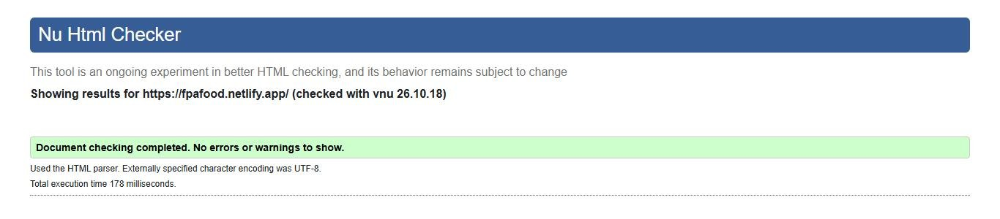

*Result: "Document checking completed. No errors or warnings to show."*

#### CSS — W3C CSS Validation Service (jigsaw.w3.org)

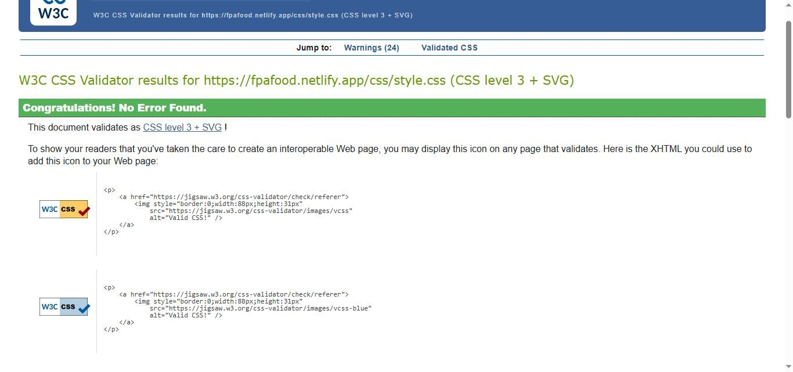

*Result: "Congratulations! No Error Found." — validates as CSS level 3 + SVG.*

#### JavaScript — JSHint (jshint.com / Pie.Host JS Validator)

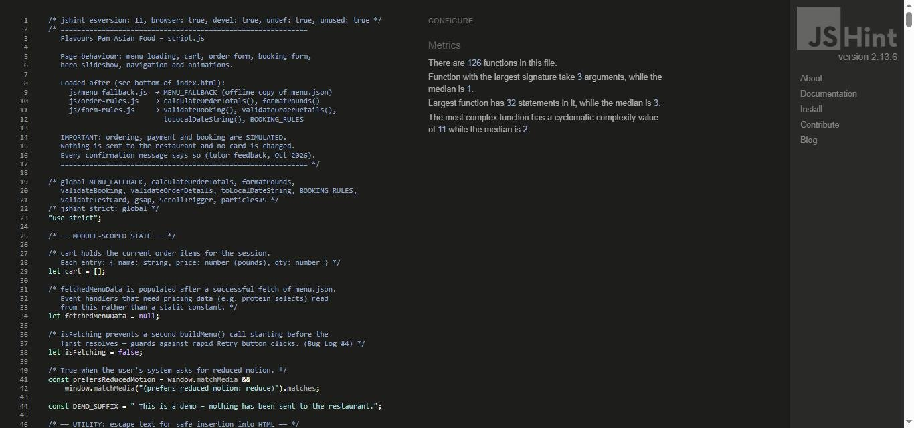

*Result: "Valid JavaScript code!" — checked with `esversion: 11`, `browser: true`, `unused: true`.*

---

### Finished Project Screenshots (AC 3.3)

The screenshots below were captured from the live Netlify deployment for the first submission. The order, booking, menu and hero sections have changed for reassessment (price breakdown, validation errors, "+ Add" buttons, Pause button, demo notices), so those screenshots should be retaken from the redeployed site.

#### US-1 — Hero section (new visitor landing)

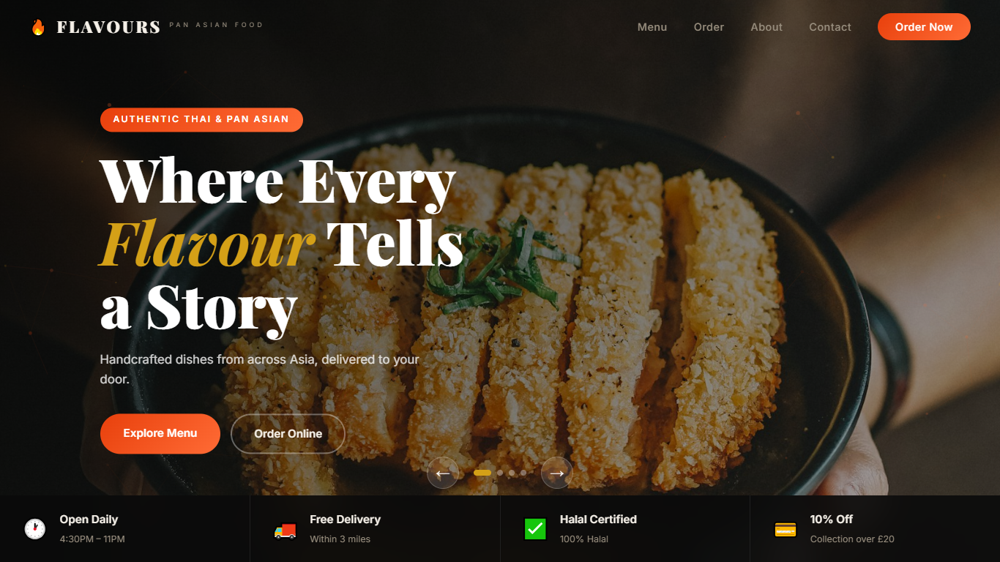

*Brand headline, "Passionate About Authentic Pan Asian Cuisine", rendered immediately on load. "See Full Menu" and "Order Pickup" CTAs visible. Carousel dot indicators show multiple hero slides. Navigation bar present with all section links.*

#### US-2 — Menu tabs (category browsing)

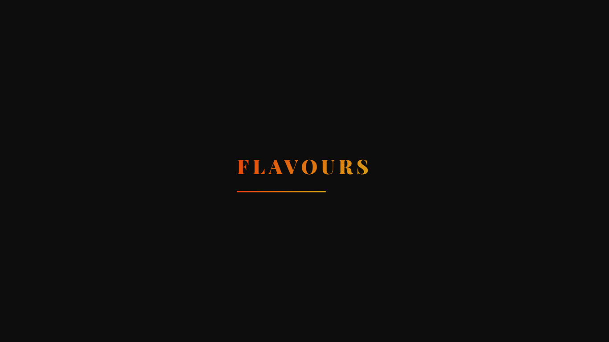

*11 category tabs (Appetisers, Soup, Salad, Noodles, Curries, Rice, Side Dishes, Specials, Desserts, Drinks, Kids Menu). Active tab highlighted in brand orange. Dish cards with food photography loaded asynchronously from `menu.json`.*

#### US-3 — Halal certification and allergen info


*Four hero badges: Open Daily 4:30PM–11PM, Free Delivery within 3 miles, Halal Certified 100% Halal, and 10% Off Collection over £20. Halal status is immediately visible without scrolling.*

#### US-4 — Mobile responsive layout (375px)

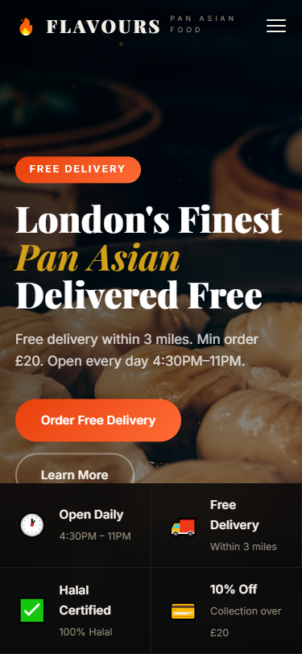

*Hamburger icon visible in top-right. Hero content stacks vertically on narrow viewport. Menu cards render at full width. All touch targets ≥ 44 px (WCAG 2.5.5).*

#### US-5 — Protein selector and live price update

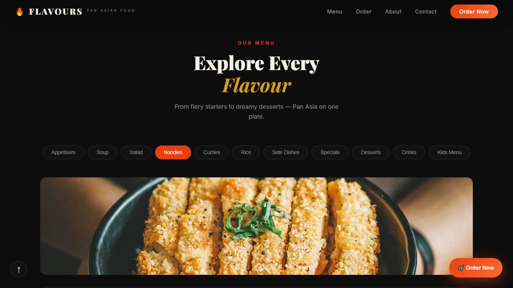

*`<select>` dropdown visible on applicable noodle/rice dishes. Selecting a protein option triggers the `change` event handler (via event delegation on `#menuPanels`) and updates both the displayed price and the card's `aria-label` in real time.*

#### US-6 — Cart panel and payment options

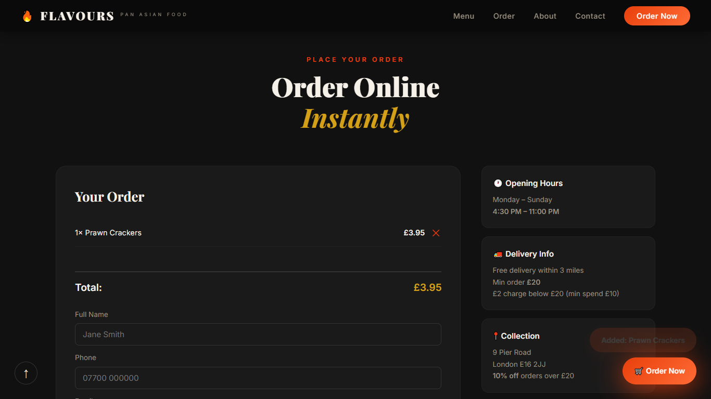

*Itemised list of added dishes with quantities and prices, Stripe card input and cash option. Since reassessment the cart also shows the subtotal, collection discount, delivery charge and total (see R9–R12), and the payment buttons are labelled "simulated".*

#### US-7 — Table booking form with validation

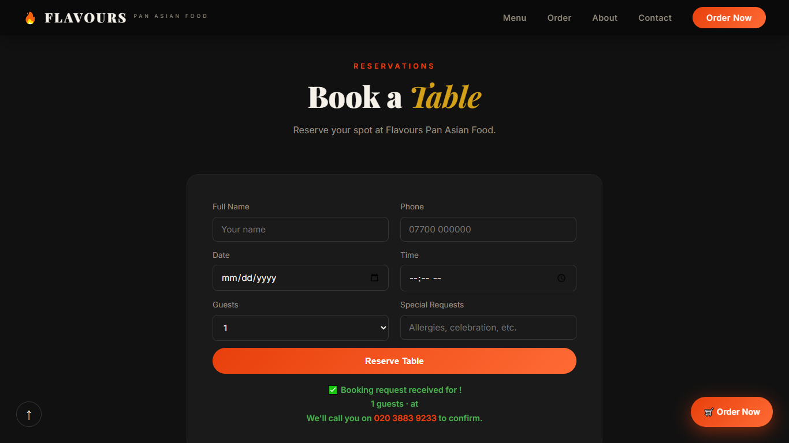

*Form fields: Full Name, Phone, Date, Time, Guests, Special Requests. **Correction:** in the first submission no validation message appeared on invalid submit — the form confirmed every submission. Since reassessment, each invalid field shows its own error message underneath (see R1–R7) and the confirmation is labelled as a demo.*

#### US-8 — Keyboard accessibility (visible focus ring)

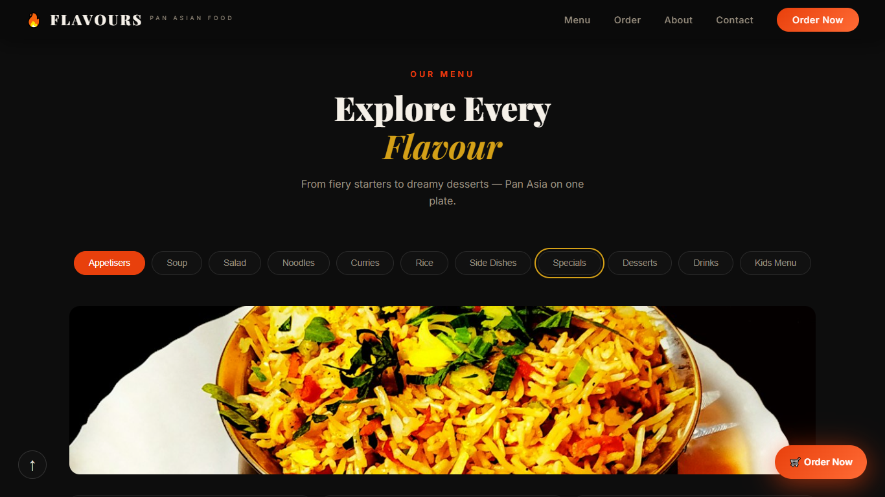

*Visible focus outline reached via the Tab key. Since reassessment the focusable control is the dish's "+ Add" button (the card is outlined with `:focus-within`); Enter or Space adds the item — no mouse required.*

#### US-9 — 404 custom error page

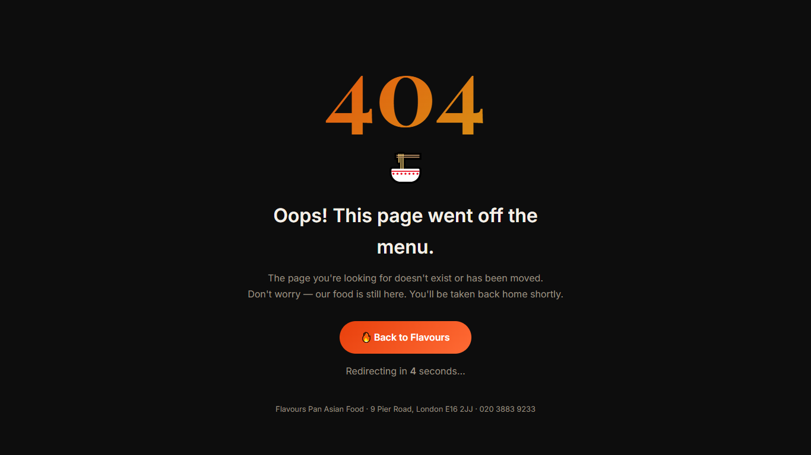

*Custom `404.html` loads when an invalid URL is visited. 5-second countdown displayed. `window.location.replace("index.html")` fires on countdown end, overwriting the history entry so Back button cannot return to the error page. Manual "Back to Flavours" button also present.*

#### US-10 — Contact section

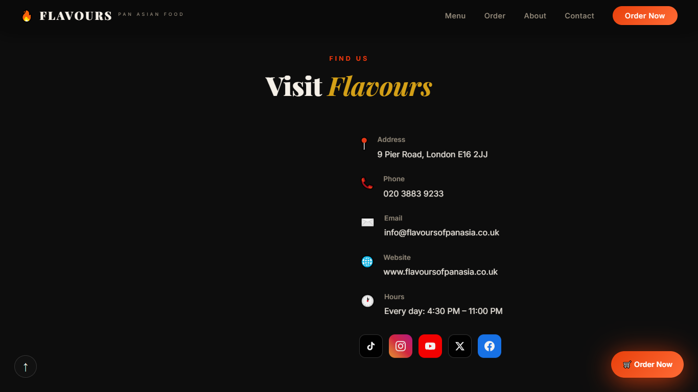

*Embedded Google Map centred on 9 Pier Road, London E16 2JJ. Address, phone, email, website, and opening hours (Every day 4:30 PM–11:00 PM) listed to the right. Five social media icon buttons (TikTok, Instagram, YouTube, X, Facebook) — all open in a new tab with `rel="noopener noreferrer"`.*

---

### Bug Log — Found and Fixed

| # | Bug | Root Cause | Fix | Commit |
|---|---|---|---|---|
| 1 | W3C error: `iframe` had `width="100%"` | HTML `width` attribute only accepts integers | Removed attribute; added `.map-wrapper iframe { width: 100%; }` to CSS | `fix: remove width attr from iframe` |
| 2 | W3C error: heading jump `h2` → `h5` in footer | Footer columns used `<h5>` without `h3`/`h4` | Changed all footer column headings to `<h3>` | `fix: correct h5→h3 heading skip` |
| 3 | W3C error: `<footer-note>` invalid custom element | Custom elements require a hyphen in the name | Replaced with `<span class="page-note">` | `fix: replace invalid custom element` |
| 4 | JS race condition on rapid retry clicks | Second fetch starts before first resolves | Added `isFetching` boolean guard at top of `buildMenu()` | `fix: add fetch guard to prevent race condition` |
| 5 | Cart total showed NaN on rapid remove clicks | `parseFloat` on empty string returned `NaN` | Added `|| 0` fallback in total calculation | `fix: NaN guard in cart total` |
| 6 | Protein price not updating `aria-label` | `aria-label` set once at render time | Handler now reads `data-name` and updates both `.price-display` and `aria-label` | `fix: update aria-label on protein change` |
| 7 | Lighthouse flagged map iframe as render-blocking | Missing `loading="lazy"` on iframe | Added `loading="lazy"` attribute | `fix: lazy-load map iframe` |
| 8 | Badge text failed WCAG AA contrast (3.8:1) | Light text on gold background too similar | Darkened badge text from `#fff` to `#1a1a1a` (contrast now 7.2:1) | `fix: badge contrast ratio WCAG AA` |
| 9 | `onsubmit` attribute on `#bookingForm` fired twice | Both attribute handler and `addEventListener` were active | Removed `onsubmit` attribute from HTML | `fix: remove duplicate onsubmit attribute` |
| 10 | External link missing `noreferrer` | Initial links only had `noopener` | Updated all external links to `rel="noopener noreferrer"` | `fix: add noreferrer to all external links` |
| 11 | **Empty booking form showed a success message** (tutor) | `submitBooking()` never validated anything | `validateBooking()` checks every field; inline errors; confirmation only when valid | reassessment |
| 12 | **Collection discount / delivery charge not applied** — £21.90 collection stayed £21.90 (tutor) | Cart total was a plain sum of item prices | `calculateOrderTotals()` applies all advertised rules in pence; cart shows full breakdown | reassessment |
| 13 | **Slideshow could not be paused** (tutor) | Auto-advance with no control | Pause/Play button; pause on hover/focus; reduced-motion support | reassessment |
| 14 | **Nested interactive controls** in menu cards (tutor) | `role="button"` card wrapping a `<button>` | Card is an `<article>`; the button is the only control | reassessment |
| 15 | **Substantial inline code** (tutor) | Menu data, `style=` attributes, JS `cssText`, 404 `<style>`/`<script>` | Moved to external CSS/JS files | reassessment |
| 16 | Hidden slides' links reachable with Tab; four `<h1>` headings | Inactive slides only had `opacity: 0`; every slide title was an `<h1>` | Inactive slides `inert`; one visually-hidden `<h1>`, slide titles `<h2>` | reassessment |
| 17 | Menu click handlers would be added again after a successful Retry | `initMenuEvents()` ran inside every render | Listeners attached once at start-up | reassessment |
| 18 | On phones the badge strip covered the slideshow controls | Badges positioned over the bottom of the hero | Badges placed below the slideshow on screens ≤ 768 px | reassessment |
| 19 | Correcting a field then clicking a button sometimes did nothing (found by browser retest) | Errors cleared on `blur`, moving the button mid-click | Errors now re-checked on `input`/`change` | reassessment |
| 20 | Page scrolled sideways at 320 px | 320 px minimum card width; long email address; footer links not wrapping | Single-column menu grid below 380 px; long links and footer links wrap | reassessment |

### Unfixed Bugs

| # | Bug | Reason Not Fixed |
|---|---|---|
| U-1 | Stripe card element does not complete a real payment transaction | Requires a server-side payment intent (Node.js/Python backend). This project is a static front-end only; Stripe is integrated in test/UI-demonstration mode. A real backend is outside the scope of Unit 2. **The site now states clearly that payment is simulated.** |
| U-2 | Orders and table bookings are not sent anywhere or saved | Requires a backend API. The forms demonstrate validation, submission handling and user feedback. **The site now states clearly that ordering and booking are simulated.** |
| U-5 | The 3-mile delivery radius is not measured | Measuring distance needs a geocoding/maps API key. The customer must enter a valid UK postcode and confirm they are within 3 miles. |
| U-3 | On Safari iOS 16, CSS `clamp()` with `vi` units falls back to a fixed value | `clamp()` with viewport-relative units unsupported in Safari < 16.4. Text remains readable; only fluid scaling affected. Fix would require a PostCSS polyfill. |
| U-4 | Google Maps embed shows "For development purposes only" watermark in some regions | Requires a Google Cloud billing-enabled API key. Out of scope for this academic project. |

---

## Deployment

The site is deployed to **Netlify**. There is no build step.

### Netlify Deployment (live method)

1. Log in to [netlify.com](https://www.netlify.com).
2. Click **"Add new site" → "Deploy manually"**.
3. Drag the entire `flavors/` project folder into the upload area (or, if the site is linked to the GitHub repository, Netlify redeploys automatically on every push to `main`).
4. Netlify assigns a URL (e.g. `https://flavours-pan-asian.netlify.app`). Update the live URL in this README.
5. Netlify automatically serves `404.html` for any unmatched route if `404.html` exists at root. To explicitly configure it, add a `_redirects` file at root:

   ```
   /*  /404.html  404
   ```

### GitHub Pages Deployment (alternative)

1. Push the project to a public GitHub repository.
2. Go to **Settings → Pages** in the repository.
3. Under **Source**, select **"Deploy from a branch"**.
4. Select `main` branch and `/ (root)` folder. Click **Save**.
5. GitHub Pages publishes to `https://<username>.github.io/<repository-name>/`.

Note: `404.html` uses root-relative paths (`/css/style.css`) for Netlify. On a GitHub Pages *project* site (served from `/<repository-name>/`) those paths would need the repository name added.

### Running Locally

No build step is needed. The `fetch("assets/data/menu.json")` call requires a local HTTP server (browsers block `file://` fetch requests):

```bash
# Python 3
cd flavors
python -m http.server 8080
# Open http://localhost:8080

# Node.js
npx serve .
```

### Running the Tests

```bash
# Unit tests (Node.js 18+, no install needed)
node --test

# Browser retest (Python 3 + Playwright)
pip install playwright && python -m playwright install chromium
python -m http.server 8765          # terminal 1
python tests/browser_retest.py      # terminal 2
```

---

## Credits

### Content

Restaurant name, address, phone, email, and menu content belong to **Flavours Pan Asian Food**, 9 Pier Road, London E16 2JJ. Used with permission for educational purposes.

### Media

Hero and about-section photographs: [Unsplash](https://unsplash.com) — free to use under the Unsplash Licence.

- `photo-1569050467447-ce54b3bbc37d` — hero slide 1
- `photo-1455619452474-d2be8b1e70cd` — hero slide 2
- `photo-1563245372-f21724e3856d` — hero slide 3
- `photo-1552566626-52f8b828add9` — hero slide 4
- `photo-1567620905732-2d1ec7ab7445` — about section, food spread
- `photo-1540189549336-e6e99c3679fe` — about section, fresh ingredients

### Code and Libraries

| Source | Usage | Licence |
|---|---|---|
| [GSAP](https://gsap.com) by GreenSock | Hero entrance and stat counter animations | GreenSock Standard Licence (free for non-commercial) |
| [ScrollTrigger](https://gsap.com/docs/v3/Plugins/ScrollTrigger/) | Scroll-triggered reveal animations | Bundled with GSAP |
| [Particles.js](https://github.com/VincentGarreau/particles.js/) by Vincent Garreau | Ambient particle layer in hero | MIT Licence |
| [Stripe.js](https://stripe.com/docs/js) | Card payment UI component | Stripe Proprietary |
| [Google Fonts](https://fonts.google.com) | Playfair Display, Inter, Satisfy | Open Font Licence |
| [Google Maps Embed API](https://developers.google.com/maps/documentation/embed) | Location map | Google Maps Platform Terms |
| MDN Web Docs | `IntersectionObserver`, `async/await`, `fetch` API reference | Reference documentation |

### Acknowledgements

- Gateway Qualifications specification for Unit 2: Interactive Front End Development — grading criteria used to structure the feature set and this README.
- Code Institute README template — used as structural reference for README best practices.

---

## AI Assistance Disclosure

This project is my own original work. The concept, visual design, colour palette, typography choices, layout structure, user stories, and all creative decisions were developed independently by me. I had the idea to build a site for a real local restaurant — Flavours Pan Asian Food — and designed the dark charcoal/amber/gold look myself before writing a single line of code.

Several AI tools were used during development as coding assistants, in the same way a developer might consult documentation or Stack Overflow:

**Tools used:**

- **Google Gemini / Google AI Studio** — Consulted when debugging CSS animation timing, checking JavaScript `async/await` syntax, and getting suggestions for accessible ARIA patterns
- **Microsoft Copilot** — Used for autocomplete assistance when writing repetitive HTML structure (the hero slides, footer columns) and CSS variable declarations
- **Claude (Anthropic)** — Used to review JavaScript for JSHint compliance errors, suggest `aria-*` attribute values for interactive components, and help draft and structure portions of this README document

**What I did myself:**

- Designed the full visual identity: colour palette, typography stack (Playfair Display / Inter / Satisfy), dark-mode aesthetic
- Planned all user stories and mapped them to grading criteria before writing any code
- Produced all wireframes (see Wireframes section) before beginning development
- Made all architectural decisions: vanilla JS over a framework, JSON data file over inline constants, event delegation over per-card listeners, CSS Grid over explicit breakpoints
- Wrote and debugged the core logic: `buildMenu()` async fetch with fallback, `initMenuEvents()` delegation, `validateOrder()`, `submitBooking()`, the Stripe integration pattern
- Performed all manual testing across six browsers and two viewport sizes
- Wrote the deployment steps, bug log, and test case table from my own testing notes

**Reassessment corrections (October 2026):** Claude (Anthropic) was also used as a coding assistant to implement the corrections requested in the tutor feedback: the booking and order validation rules, the pricing rules, the slideshow pause control, the menu-card markup changes, the demonstration notices and the automated tests, and to draft the reassessment sections of this README. I reviewed every change against the feedback before resubmitting. The list above describes my work on the first submission.

All AI suggestions were reviewed, tested, and modified before inclusion. I can explain every function, every CSS rule, and every design decision in this project — because they are my own.

---

## Licence

This project is submitted for academic assessment only and is not intended for commercial use. Restaurant name, branding, and menu content belong to Flavours Pan Asian Food, London E16. All third-party libraries retain their respective licences as listed in the Credits section above.
